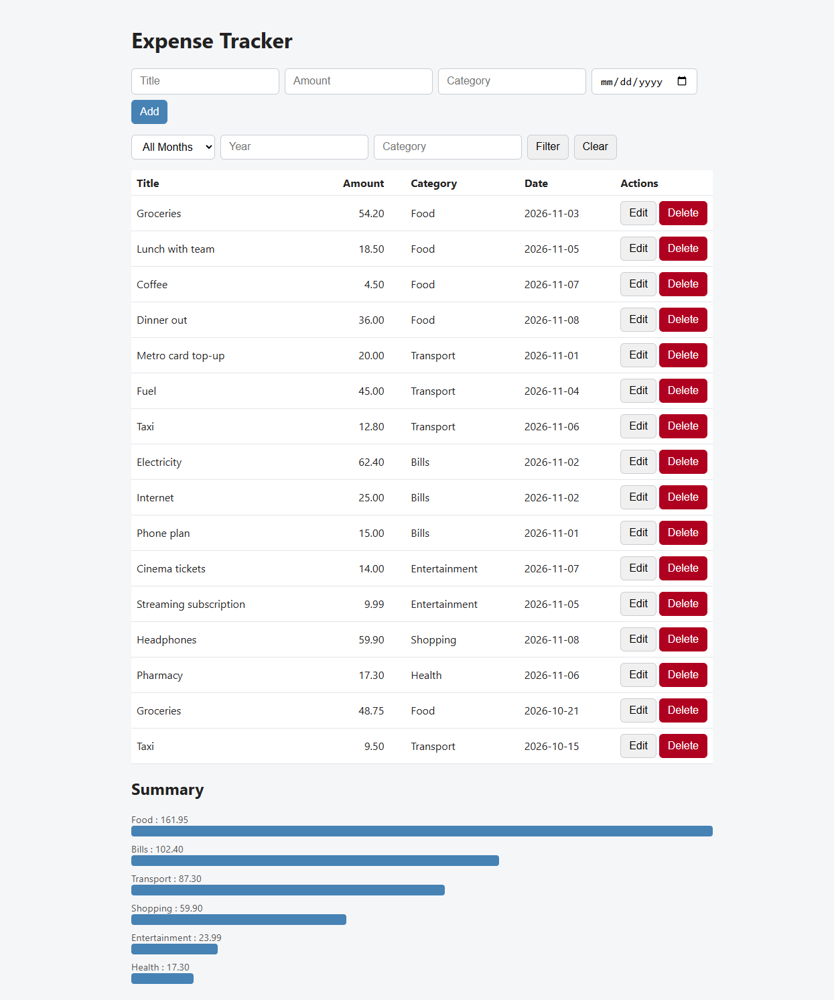

# Expense Tracker

A small full-stack app for tracking personal expenses: a REST API built with ASP.NET Core and EF Core (SQLite), and a React + TypeScript frontend built with Vite.

**Live demo:** [expensetracker-oet7.onrender.com](https://expensetracker-oet7.onrender.com/)
*(Hosted on a free tier, so the first load can take up to a minute to wake up. Data resets on each redeploy.)*



## Features
- Create, read, update and delete expenses
- Filter by month, year and category
- Spending summary per category, shown as a bar chart
- Input validation with clear error messages, shown on the page
- Responsive layout that works on a phone

## Run it
You need the .NET SDK (10.x) and Node.js (22 or newer).

1. `dotnet tool install --global dotnet-ef`
2. `dotnet ef database update`
3. Build the frontend (in the `frontend` folder):
   ```
   npm ci
   npm run build
   ```
   This puts the built React app in `wwwroot`, where ASP.NET serves it.
4. `dotnet run` (in the root folder)
5. Open the address shown in the terminal (for example `http://localhost:5254/`)

Use `ExpenseTracker.http` to try the API endpoints directly.

### Frontend development
For live reload while working on the React app, run both:
- `dotnet run` in the root folder (the API)
- `npm run dev` in the `frontend` folder, then open `http://localhost:5173/`

Vite forwards `/expenses` requests to the API, so no extra setup is needed.

## Project structure
- `Endpoints/`, `Models/`, `Data/`, `Migrations/`: the ASP.NET Core API and database
- `frontend/src/App.tsx`: app state, API calls and handlers
- `frontend/src/components/`: `ExpenseForm`, `Filters`, `ExpenseList`, `SummaryChart`, each with its own CSS file
- `frontend/src/types.ts`: shared TypeScript types matching the API
- `ExpenseTracker.Tests/`: integration tests

## Tests
Automated API tests use xUnit and `WebApplicationFactory`. Each test run starts the real app against a temporary SQLite database, so your own data is never touched.

```
dotnet test ExpenseTracker.Tests
```

They cover the health check, creating expenses (valid and invalid data), getting one by id, a missing id (404) and deleting.

## Endpoints
| Method | Path | Description |
|---|---|---|
| GET | /ping | Health check, returns "pong" |
| GET | /expenses | List expenses (optional month, year, category) |
| GET | /expenses/{id} | Get one expense |
| POST | /expenses | Create an expense |
| PUT | /expenses/{id} | Update an expense |
| DELETE | /expenses/{id} | Delete an expense |
| GET | /expenses/summary | Totals per category (optional month, year) |

## Tech
- C#, ASP.NET Core minimal APIs, EF Core with SQLite
- React 19 and TypeScript, built with Vite
- xUnit and `WebApplicationFactory` for integration tests
- Docker multi-stage build: a Node stage builds the React app, a .NET stage publishes the API, and a small runtime image serves both. Deployed on Render, which rebuilds on every push to `main`.
