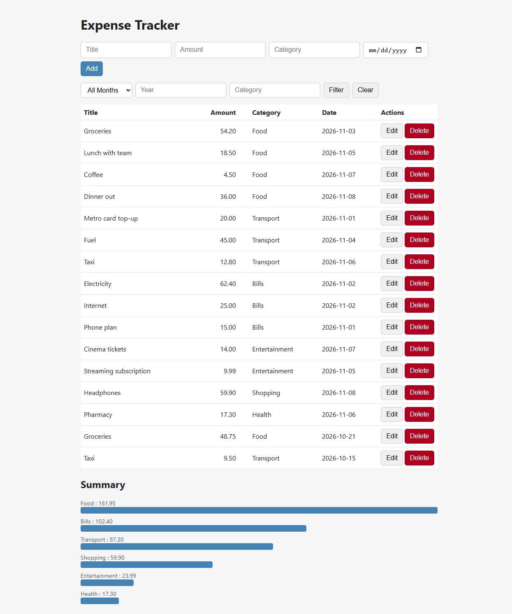

# Expense Tracker

A small full-stack app for tracking personal expenses: a REST API built with ASP.NET Core and EF Core (SQLite), plus a plain HTML, CSS and JavaScript web page.

**Live demo:** [expensetracker-oet7.onrender.com](https://expensetracker-oet7.onrender.com/)
*(Hosted on a free tier, so the first load can take about 30 seconds to wake up.)*

## Features
- Create, read, update and delete expenses
- Filter by month, year and category
- Spending summary per category, shown as a bar chart
- Input validation with clear error messages, shown on the page
- Responsive layout that works on a phone

## Run it
1. Install the .NET SDK (10.x)
2. `dotnet tool install --global dotnet-ef`
3. `dotnet ef database update`
4. `dotnet run`
5. Open the address shown in the terminal (for example `http://localhost:5254/`) to use the web page

Use `ExpenseTracker.http` to try the API endpoints directly.

## Endpoints
| Method | Path | Description |
|---|---|---|
| GET | /ping | Health check, returns "pong" |
| GET | /expenses | List expenses (optional month, year, category) |
| GET | /expenses/{id} | Get one expense |
| POST | /expenses | Create an expense |
| PUT | /expenses/{id} | Update an expense |
| DELETE | /expenses/{id} | Delete an expense |
| GET | /expenses/summary | Totals per category (optional month, year) |

## Tech
- C#, ASP.NET Core minimal APIs, EF Core with SQLite
- Plain JavaScript (`fetch`), HTML and CSS, served from `wwwroot`